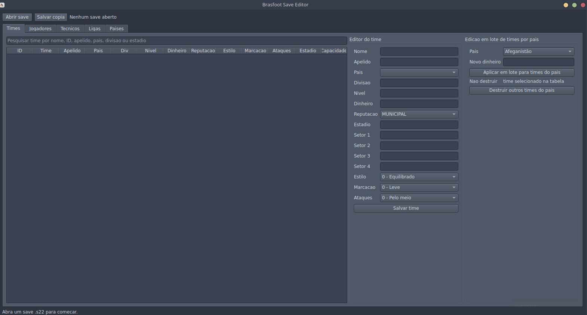
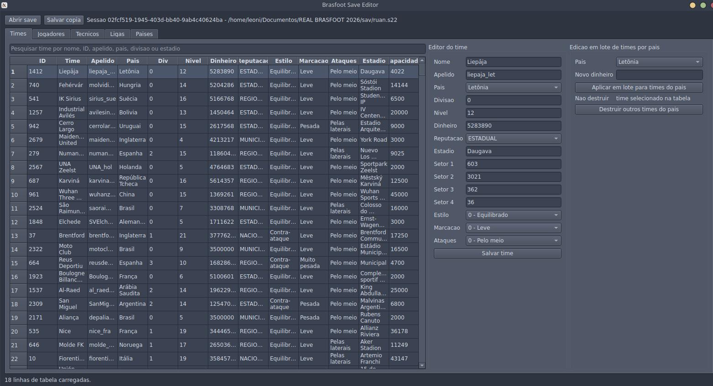
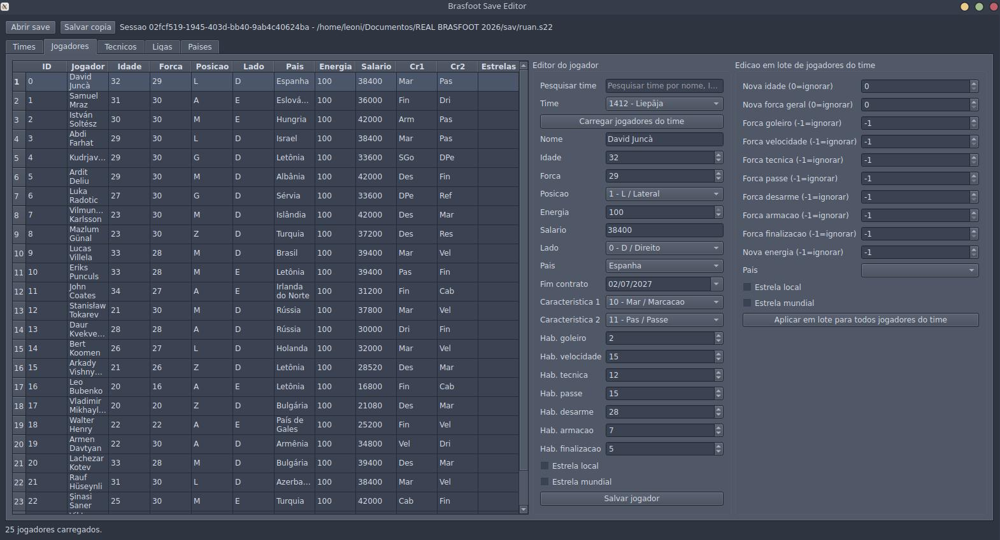

# Brasfoot Save Editor

Editor desktop para saves `.s22` do Brasfoot, construido em Java 17, Spring Boot e Swing + FlatLaf. O projeto abre um save local, mantem os dados em uma sessao em memoria, permite editar informacoes importantes do jogo e pode substituir o save atual ou gravar uma copia com outro nome.

## Visao Geral

O Brasfoot Save Editor nasceu para facilitar ajustes em saves do Brasfoot sem depender da interface original do jogo. A aplicacao trabalha diretamente com os objetos serializados por meio de Kryo e das classes carregadas do `.exe` ou `.jar` selecionado pelo usuario, expondo uma UI desktop para navegar e alterar times, jogadores, tecnicos, ligas e paises.

Principais objetivos do projeto:

- abrir saves `.s22` locais;
- carregar o `.exe` ou `.jar` do Brasfoot escolhido pelo usuario, sem distribuir arquivos proprietarios do jogo;
- visualizar os dados carregados em tabelas organizadas;
- editar campos ja mapeados e validados no save;
- aplicar alteracoes em lote para cenarios de teste ou customizacao;
- escolher entre substituir o arquivo atual ou salvar uma copia com outro nome;
- manter a regra de negocio isolada da interface por uma arquitetura em camadas/hexagonal.

## Downloads Oficiais

A release atual esta disponivel em [v1.0.0](https://github.com/leonifrazao/brasfoot-save-editor/releases/tag/v1.0.0).

- [brasfoot-save-editor-windows.zip](https://github.com/leonifrazao/brasfoot-save-editor/releases/download/v1.0.0/brasfoot-save-editor-windows.zip): recomendado para Windows. Ja inclui runtime Java; basta extrair o ZIP e executar `brasfoot-save-editor.exe`.
- [brasfoot-save-editor.jar](https://github.com/leonifrazao/brasfoot-save-editor/releases/download/v1.0.0/brasfoot-save-editor.jar): alternativa multiplataforma. Requer Java 17 instalado e pode ser executado com `java -jar brasfoot-save-editor.jar`.

O editor nao inclui arquivos do Brasfoot. Ao abrir o programa, clique em `Selecionar Brasfoot` e escolha o `.exe` ou `.jar` da sua propria instalacao do Brasfoot antes de abrir o save `.s22`.

## Capturas De Tela

### Tela Principal



### Dados Carregados



### Jogadores



## Funcionalidades

- Abertura de arquivos `.s22` por seletor de arquivo da interface Swing.
- Salvamento com escolha entre substituir o arquivo aberto (com confirmacao) ou gravar uma nova copia no mesmo diretorio.
- Listagem e filtro de times por nome, ID, apelido, pais, divisao ou estadio.
- Edicao de times: nome, apelido, pais, divisao, nivel, dinheiro, reputacao, estadio, setores do estadio e parametros taticos.
- Edicao em lote de times, incluindo dinheiro, reputacao, estadio, nivel e estilo; permite enfraquecer todos os times ou preservar os associados a tecnicos humanos.
- Listagem de jogadores por time.
- Edicao de jogadores: nome, idade, forca geral, posicao, energia, salario, lado, pais, fim de contrato, caracteristicas, habilidades individuais e estrelas.
- Edicao em lote de jogadores do time selecionado: idade, forca geral, energia, pais, habilidades individuais e estrelas.
- Edicao de tecnicos: nome, time, tecnico humano, confianca da diretoria e confianca da torcida.
- Visualizacao de ligas/campeonatos e edicao de linhas da tabela: pontos, vitorias, empates, derrotas, gols pro e gols contra.
- Visualizacao e filtro de paises, com edicao do nivel/forca do pais.
- Logs estruturados em JSON Lines para diagnostico local.
- Testes de dominio, services e regras arquiteturais com ArchUnit.

## Como Funciona O Fluxo De Save

1. O usuario escolhe o `.exe` ou `.jar` do Brasfoot na interface.
2. O editor carrega as classes `best.*` do arquivo selecionado em runtime.
3. O usuario escolhe um arquivo `.s22` na interface.
4. O `SessionService` le o arquivo e cria uma sessao com UUID.
5. O adapter `KryoSaveAdapter` desserializa o payload usando `SaveFileService` e Kryo.
6. O estado do save fica em memoria por meio de `CurrentSessionAdapter` e `SaveContext`.
7. Os services de aplicacao alteram apenas os campos mapeados no dominio.
8. Ao salvar, escolha substituir o arquivo aberto ou criar uma copia nova no diretorio do save original.

O envelope do save e detectado automaticamente: saves antigos sem compressao continuam aceitos, e saves do Brasfoot 2026 (GZIP) mantem a compressao e recebem uma copia do arquivo `.info` associado quando ele existir.

Ao criar uma copia, o nome segue o padrao `brasfoot-save-<uuid>` e mantem a extensao original quando ela existir. A substituicao do arquivo aberto pede confirmacao antes de gravar.

## Arquitetura

O projeto segue uma organizacao inspirada em arquitetura hexagonal, separando dominio, casos de uso, portas, adapters e UI.

```text
src/main/java/br/com/saveeditor/brasfoot
|-- application
|   |-- ports/in      # contratos de entrada e casos de uso
|   |-- ports/out     # portas para estado, leitura, escrita e dados do jogo
|   |-- services      # orquestracao dos casos de uso
|   `-- shared        # respostas e resultados compartilhados
|-- debug             # ferramentas locais para investigacao de saves/bytecode
|-- domain            # modelos, estado do save, enums e validacoes
|-- infrastructure
|   `-- adapters      # adapters Swing, arquivo/Kryo e estado em memoria
|-- presentation      # presenter, view contract e modelos de tela
|-- service           # servicos legados/infra para Kryo e dados do jogo
`-- util              # constantes e utilitarios de reflexao/string/console
```

### Camadas Principais

- `domain`: entidades e regras do save, como `Team`, `Player`, `Manager`, `League`, `SaveContext` e enums mapeados do Brasfoot.
- `application`: services e portas que coordenam leitura, atualizacao e escrita sem depender diretamente da UI.
- `presentation`: `BrasfootPresenter`, modelos de tela e contrato `BrasfootDesktopView`.
- `infrastructure`: implementacoes concretas para Swing, Kryo e armazenamento de sessoes em memoria.
- `debug`: utilitarios para investigar saves reais, classes obfuscadas do Brasfoot e campos ainda nao confirmados.

A interface desktop e Java Swing + FlatLaf. O Spring Boot e usado como container de injecao de dependencias, mas a aplicacao roda com `WebApplicationType.NONE`: nao existe API REST nem frontend web.

## Tecnologias

| Tecnologia | Uso |
| --- | --- |
| Java 17 | linguagem principal |
| Spring Boot 3.2.1 | injecao de dependencias e bootstrap da aplicacao desktop |
| Swing + FlatLaf | interface grafica desktop |
| Kryo 4.0.2 | desserializacao/serializacao dos saves |
| Lombok | reducao de boilerplate em modelos |
| ArchUnit | validacao de regras arquiteturais nos testes |
| Logback + logstash encoder | logs estruturados em JSON Lines |
| Nix | ambiente reprodutivel de desenvolvimento |

## Requisitos

- Para usar o ZIP Windows: nenhum requisito adicional; o runtime Java 17 vai embutido.
- Para usar o JAR multiplataforma: Java 17.
- Para desenvolvimento: Java 17 e Maven. Swing vem incluido no Java; FlatLaf e baixado pelo Maven.
- Para desenvolvimento local: bibliotecas auxiliares em `lib/` (`asm`, `reflectasm` e `minlog`). O Maven resolve `objenesis` como dependência.
- Um `.exe` ou `.jar` do Brasfoot instalado pelo usuario, selecionado pela interface ao iniciar o fluxo de uso.

A interface usa Swing com FlatLaf e nao requer bibliotecas graficas nativas adicionais.

Arquivos auxiliares locais esperados pelo `pom.xml` para desenvolvimento:

- `lib/asm-5.1-es.jar`
- `lib/reflectasm-1.11.5.jar`
- `lib/minlog-1.3.0.jar`

## Como Executar

### Usando Release Windows

1. Baixe [`brasfoot-save-editor-windows.zip`](https://github.com/leonifrazao/brasfoot-save-editor/releases/download/v1.0.0/brasfoot-save-editor-windows.zip).
2. Extraia o ZIP.
3. Execute `brasfoot-save-editor.exe`.
4. Clique em `Selecionar Brasfoot` e escolha o `.exe` ou `.jar` da sua instalacao do Brasfoot.
5. Clique em `Abrir save` e escolha o save `.s22`.

### Usando JAR Multiplataforma

Baixe [`brasfoot-save-editor.jar`](https://github.com/leonifrazao/brasfoot-save-editor/releases/download/v1.0.0/brasfoot-save-editor.jar) e execute:

```bash
java -jar brasfoot-save-editor.jar
```

### Usando Ambiente Local

Execute os testes:

```bash
mvn test
```

Abra a aplicacao desktop:

```bash
mvn spring-boot:run
```

### Usando Nix

Se o ambiente local nao tiver Java ou Maven instalados, use o `shell.nix` do projeto.

Entrar no shell:

```bash
nix-shell
```

Executar testes dentro do shell:

```bash
mvn test
```

Abrir a aplicacao dentro do shell:

```bash
mvn spring-boot:run
```

Tambem e possivel executar comandos diretamente:

```bash
nix-shell --run "mvn test"
```

```bash
nix-shell --run "mvn spring-boot:run"
```

## Guia Rapido De Uso

1. Inicie a aplicacao.
2. Clique em `Selecionar Brasfoot`.
3. Selecione o `.exe` ou `.jar` da sua instalacao do Brasfoot.
4. Clique em `Abrir save`.
5. Selecione um arquivo `.s22` do Brasfoot.
6. Aguarde o carregamento das abas de times, tecnicos, ligas e paises.
7. Selecione um registro em uma tabela para preencher o editor lateral.
8. Nas abas Times e Jogadores, selecione o registro e use `Aplicar alterações` no painel lateral. Nas outras abas, use o botão de edição da própria área.
9. Para jogadores, pesquise o time pelo nome e selecione-o para carregar o elenco.
10. Quando terminar, clique em `Salvar…` e escolha substituir o save aberto ou salvar com outro nome.
11. Teste o save no Brasfoot antes de continuar a partida.

## Abas Da Interface

### Times

Permite pesquisar times e editar informacoes estruturais do clube. Campos suportados incluem nome, apelido, pais, divisao, nivel, dinheiro, reputacao, estadio, setores do estadio, estilo de jogo, marcacao e foco dos ataques. Estilos e focos exclusivos do Real Brasfoot aparecem somente quando a biblioteca Real e detectada; no Brasfoot original, a lista e limitada aos valores disponiveis nessa versao.

Selecione um time na tabela para abrir o formulário lateral. Use `Aplicar alterações` para atualizar o save em memória ou `Descartar alterações` para restaurar os valores. Ao trocar de registro, o editor guarda o rascunho até você voltar a ele. O botão `Edição em lote` abre uma janela separada para ajustar dinheiro, reputação, estádio, nível e estilo de jogo ou enfraquecer clubes mediante confirmação.

### Jogadores

Os jogadores sao carregados por time; a busca mostra os times correspondentes enquanto o nome e digitado. A aba permite alterar dados basicos, contrato, caracteristicas, pais, estrelas e habilidades individuais como goleiro, velocidade, tecnica, passe, desarme, armacao e finalizacao.

Selecione um jogador no elenco para editar no painel lateral, com os mesmos controles de aplicar e descartar da aba Times. A janela de edição em lote atua sobre o elenco carregado e usa `-1` para manter valores numéricos. O comando `Salvar…` grava no arquivo as alterações já aplicadas.

### Tecnicos

Permite editar nome, time associado pelo nome, flag de tecnico humano e confianca da diretoria/torcida.

### Ligas

Lista as ligas encontradas no save e permite carregar a tabela de uma liga especifica. A edicao da linha recalcula `jogos` como `vitorias + empates + derrotas` para preservar coerencia basica da tabela.

### Paises

Mostra os paises mapeados no save, com filtro por nome, grupo ou ID. Atualmente expoe a edicao do nivel/forca do pais.

## Documentacao Tecnica

- `docs/field-mapping.md`: registro dos campos confirmados por save real, bytecode e reflexao.
- `scripts/save-debugger.sh`: script auxiliar para depuracao local de saves.
- `scripts/build.sh` e `scripts/build.bat`: compilam `jar`, `exe`, `exe-debug` ou `both`; sem argumento, mostram um menu de selecao.
- `scripts/build-windows-bundle.sh` e `scripts/build-windows-bundle.bat`: geram o bundle Windows com runtime Java embutido.

Para compilar, execute `scripts/build.sh` no Linux ou `scripts\\build.bat` no Windows. Escolha `jar`, `exe`, `exe-debug` ou `both` no menu, ou passe a opcao como argumento. `exe` e `both` geram `target/brasfoot-save-editor-windows.zip` com o EXE e runtime Java 17, sem JAR separado nem BAT. `exe-debug` gera `target/brasfoot-save-editor-windows-debug.zip`, que inclui tambem o JAR da aplicacao e `run-debug.bat`. O JAR funciona no Linux e no Windows com Java 17.

O mapeamento de campos e uma parte sensivel do projeto porque o Brasfoot usa classes e atributos obfuscados. Por isso, novos campos devem ser confirmados com evidencia antes de serem expostos na UI.

## Logs

Os logs sao gerados em `logs/brasfoot-save-editor.jsonl`, com rotacao diaria e por tamanho. O formato e JSON Lines, facilitando busca, filtragem e diagnostico de erros.

Configuracoes principais:

- arquivo ativo: `logs/brasfoot-save-editor.jsonl`;
- historico: ate 14 dias;
- tamanho maximo por arquivo: 10 MB;
- limite total: 200 MB;
- logger do projeto em `DEBUG` por padrao via `application.properties`.

## Testes

O comando principal de verificacao e:

```bash
mvn test
```

A suite cobre:

- validacoes de dominio;
- services de times, jogadores e tecnicos;
- dados do jogo;
- regras arquiteturais com ArchUnit.

## Cuidados E Limitacoes

- Sempre mantenha backup dos saves importantes antes de testar uma copia modificada.
- A substituicao do arquivo aberto exige confirmacao; ainda assim, mantenha backup dos saves importantes e valide o comportamento no jogo.
- Apenas campos ja mapeados devem ser alterados; campos obfuscados sem confirmacao podem corromper o save.
- O editor precisa carregar o `.exe` ou `.jar` do Brasfoot do usuario antes de abrir um save; sem isso a desserializacao pode falhar com erro de classe `best.*` nao encontrada.
- Este projeto nao distribui arquivos proprietarios do Brasfoot.
- Este projeto nao implementa servidor web, API REST ou frontend browser.

## Troubleshooting

### Erro Ao Abrir A Interface

No Windows, gere o pacote de diagnostico com `scripts\\build.bat exe-debug` e execute `run-debug.bat`; ele mostra a mensagem de erro no terminal. A interface Swing usa componentes Java multiplataforma.

### Erro Sobre Classes Do Brasfoot

Clique em `Selecionar Brasfoot` e escolha o `.exe` ou `.jar` da sua instalacao do Brasfoot. Esse arquivo e necessario para carregar classes obfuscadas do jogo usadas dentro do save.

### Save Nao Abre Ou Falha Ao Desserializar

Confirme se o arquivo e realmente um save `.s22` compativel com a versao esperada do Brasfoot. Saves de outras versoes podem ter estrutura diferente.

### Aplicacao Abre, Mas Nao Mostra Dados Esperados

Veja os logs em `logs/brasfoot-save-editor.jsonl` e confira a mensagem exibida na barra inferior da janela. Alguns dados dependem de mapeamentos ja confirmados no save.

## Estrutura De Pastas

```text
.
|-- docs/                 # imagens e documentacao de mapeamento
|-- lib/                  # dependencias auxiliares de runtime usadas no desenvolvimento
|-- logs/                 # logs estruturados gerados pela aplicacao
|-- scripts/              # scripts auxiliares de debug
|-- src/main/java/        # codigo principal
|-- src/main/resources/   # configuracoes de logging e Spring
|-- src/test/java/        # testes automatizados
|-- pom.xml               # build Maven e dependencias
`-- shell.nix             # ambiente de desenvolvimento com Java e Maven
```

## Contribuicao

Antes de alterar mapeamentos do save, registre a evidencia tecnica em `docs/field-mapping.md` ou em documento equivalente. Mudancas de dominio e services devem vir acompanhadas de testes quando possivel.

Fluxo recomendado:

1. Crie ou atualize testes para o comportamento alterado.
2. Execute `mvn test`.
3. Documente novos campos mapeados.
4. Teste manualmente com uma copia de save real.

O projeto tambem possui `CODE_OF_CONDUCT.md` para orientar interacoes de contribuicao.
